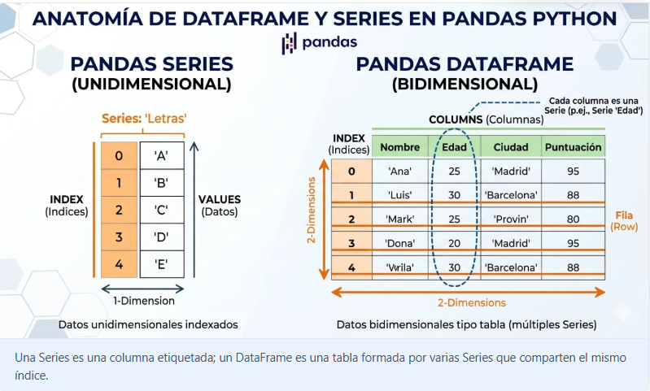
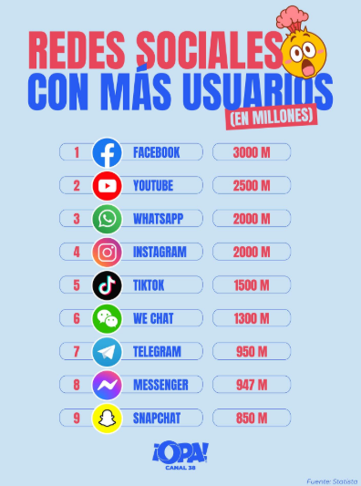
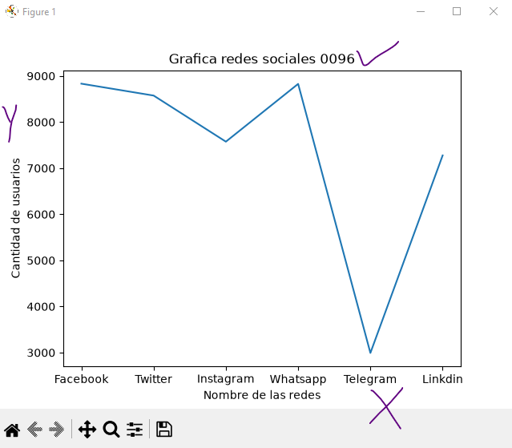
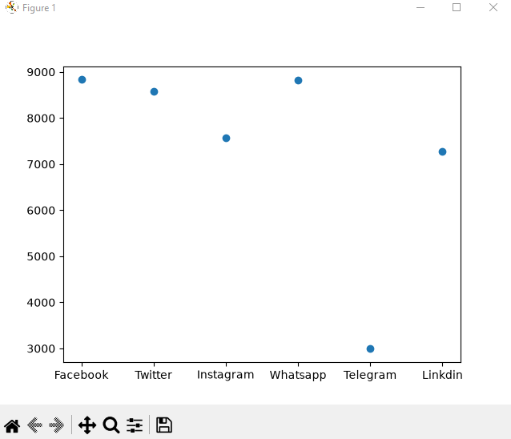
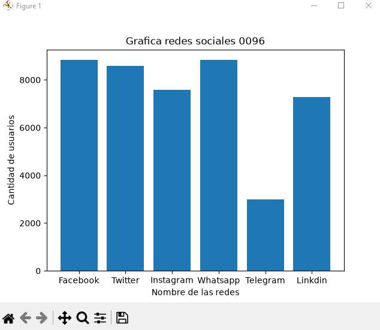
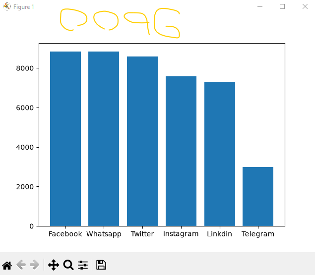
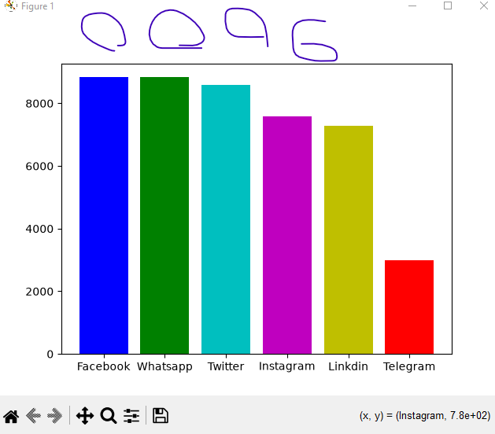
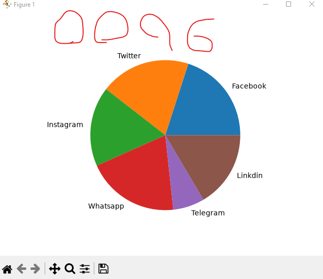

## dataframe o marco de datos pandas

## Redes sociales a nivel mundial

## Grafica lineal de redes sociales

## grafica puntos de redes sociales

## Graficas de barras de redes sociales

## grafica de barras del mas grande al mas chico

## grafica de barras a colores

## grafica pastel o pie 
